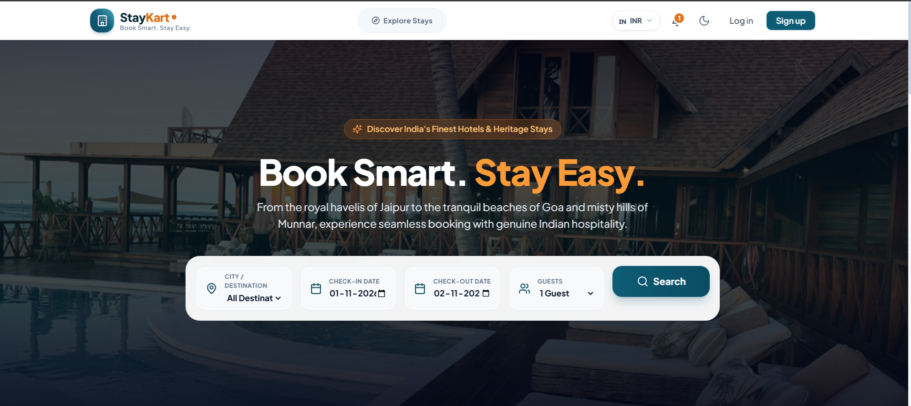
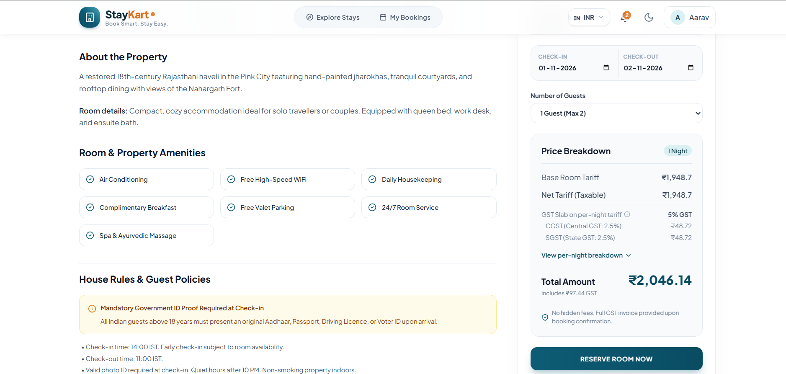

# StayKart Hotel Booking Platform

A full stack hotel booking web application with secure authentication, room booking, notifications and multi-country pricing.

**Live demo:** https://staykart-hotel-booking-platform.vercel.app
**Backend API:** https://staykart-hostel-booking-platform.onrender.com
> The backend runs on Render's free tier, so the first request may take about 50 seconds to wake up.

## Screenshots

## Features
- User signup and login with JWT authentication
- Show/hide password toggle
- Hotel and room browsing, and room booking
- Notification center: toast pop-ups plus a notification bell with history
- Country selector with currency conversion and region-based tax (GST for India, VAT for UK)
- Responsive, modern UI
## Admin Console
A dedicated admin panel for managing the whole platform:

- **Dashboard:** overview of key metrics such as bookings, revenue and occupancy
- **Occupancy Grid:** calendar-style view of room availability and booked dates
- **Properties:** add, edit and remove hotel properties
- **Rooms & Blocks:** manage rooms and room types, and block rooms for specific dates (e.g. maintenance)
- **Photo Gallery:** upload and manage property and room images
- **Pricing & Surcharges:** set room rates and apply surcharges (e.g. seasonal or weekend pricing)
- **Amenities:** manage the amenities offered, such as Wi-Fi, pool and parking
- **Bookings Ops:** view and manage bookings, including status updates and cancellations
- **User Accounts:** view and manage registered users and their roles

## Tech Stack
- **Backend:** Java, Spring Boot, Spring Security (JWT), REST APIs, Flyway
- **Database:** PostgreSQL
- **Frontend:** React
- **DevOps:** Docker, Docker Compose, GitHub Actions CI
- **Deployment:** Render (backend + database), Vercel (frontend)

## Run Locally

### Prerequisites
Java (17), Node.js, Docker

### 1. Clone
git clone https://github.com/chitra6116/staykart_hotel_booking_platform.git
cd staykart_hotel_booking_platform

### 2. Environment variables
Create a `.env` file in the project root:

POSTGRES_DB=staykart
POSTGRES_USER=staykart_user
POSTGRES_PASSWORD=your_password
JWT_SECRET=your_long_random_secret
ADMIN_PASSWORD=your_admin_password

### 3. Start the database
docker compose up -d db

### 4. Run the backend
cd backend
./mvnw spring-boot:run

### 5. Run the frontend
cd frontend
npm install
npm run dev

## Project Structure
- `backend/`: Spring Boot API
- `frontend/`: web client
- `.github/workflows/`: CI pipeline

## Author
Chitra Joshi
